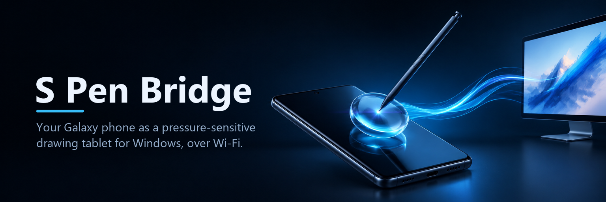
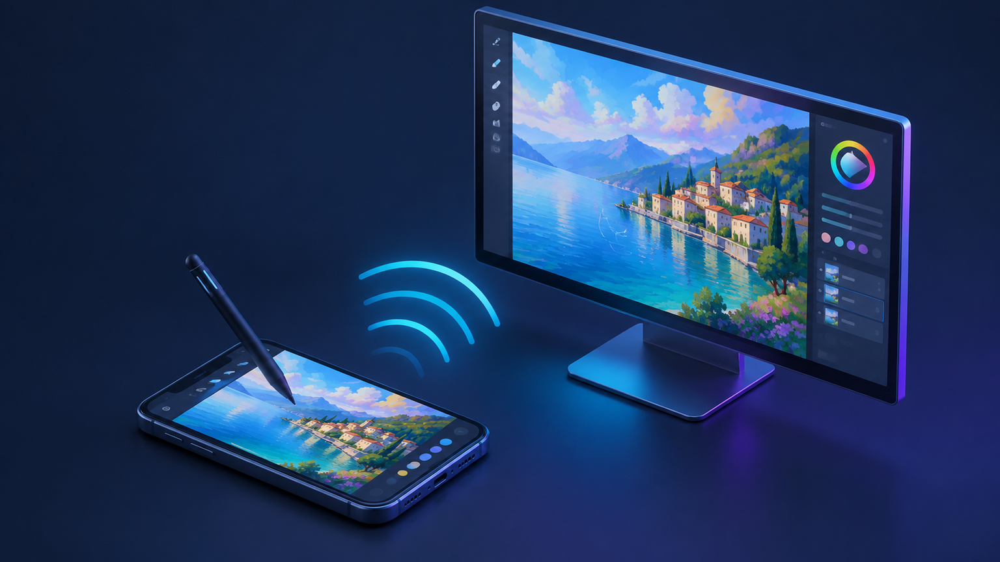
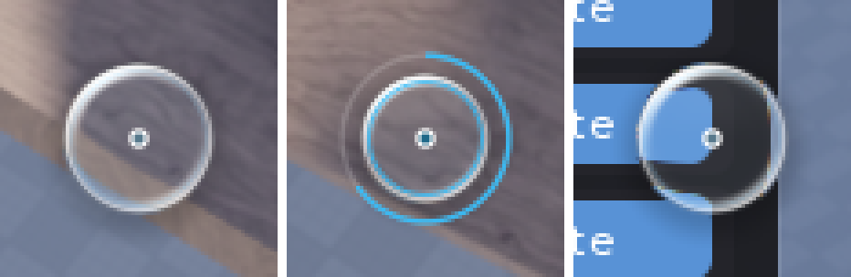

<p align="center">
  
</p>

<p align="center">
  <a href="https://github.com/arabdogwater/spen-bridge/releases/latest"></a>
  
  
  
  <a href="LICENSE"></a>
</p>

<p align="center">
  <b>Turn a Galaxy phone + S Pen into a real Windows Ink drawing tablet.</b><br>
  Pressure, side button, eraser, a liquid-glass hover lens, and a lock mode so your palm can't escape the canvas.
</p>

<p align="center">
  <a href="https://github.com/arabdogwater/spen-bridge/releases/latest/download/SpenBridge.apk"><b>⬇ Phone app (.apk)</b></a>
  &nbsp;·&nbsp;
  <a href="https://github.com/arabdogwater/spen-bridge/releases/latest/download/SpenBridge.exe"><b>⬇ PC app (.exe)</b></a>
</p>

---



## ✨ Features

| | |
|---|---|
| 🖊️ **Real pen, not a fake mouse** | Injected as a native Windows Ink pen: 1024 pressure levels, tilt, S Pen side button as the barrel button, eraser. Works in Photoshop, Krita, Clip Studio Paint, OneNote, Paint and anything else that takes pen input. |
| 🔮 **Liquid-glass hover lens** | While you hover, a refracting glass circle on the PC shows exactly where the tip will land. It's its own overlay, separate from your mouse cursor, and invisible to screenshots and screen recorders. |
| 🔒 **Tablet lock mode** | Fullscreen, screen pinned, Back / Home / Recents blocked, fingers and palm ignored. Leave by pressing **Volume Up 3 times**. |
| ⚡ **Low latency** | Unbuffered stylus events, every intermediate sample, UDP with Wi-Fi power save off and voice-priority packets. |
| 📡 **Zero setup networking** | The phone finds the PC on the same Wi-Fi by itself. Manual IP if your router blocks broadcast. |
| 🪶 **Tiny PC side** | One native 240 KB exe in the tray. No installer, no runtime, no drivers. |
| 🎛️ **S Pen Air Actions** | Pen button click = undo, double click = redo, swipes = brush size and zoom (Bluetooth S Pens). |

## 🔮 The lens

Rendered live by the PC app over whatever is under the pen. The centre stays 1:1 so the pen point is exact; only the rim bends the content.

<p align="center">
  
</p>

**The lens reacts to pen height.** High above the screen it's big; as the S Pen comes down it shrinks toward the exact point, and it's smallest while touching. This uses Android's hover-distance axis (`AXIS_DISTANCE`), normalised per device. If a phone doesn't report hover height the lens just stays a fixed size; the phone shows `hover depth ✓` in tablet mode when it works.

| Hovering | Drawing (arc = pressure) | Side button held | Eraser |
|:---:|:---:|:---:|:---:|
| ice blue | sky blue + pressure arc | amber | rose |

## 🚀 Quick start

1. **PC:** download [`SpenBridge.exe`](https://github.com/arabdogwater/spen-bridge/releases/latest/download/SpenBridge.exe) and run it. A glass icon shows up in the tray. Allow it on **Private networks** when Windows Firewall asks (or tray menu → *Allow through firewall*).
2. **Phone:** install [`SpenBridge.apk`](https://github.com/arabdogwater/spen-bridge/releases/latest/download/SpenBridge.apk) (allow "install unknown apps" for your browser or file manager).
3. Same Wi-Fi on both. Open the app, your PC appears and connects. Hit **Start tablet mode**.

### One-time phone settings

- **Pin app** (needed for the lock): Settings → Security and privacy → More security settings → **Pin app** → on.
- **Air Command:** turn off its pen-button shortcut (Settings → Advanced features → S Pen → Air command), otherwise pressing the button while hovering opens Samsung's menu.
- **Air Actions** (optional): Settings → Advanced features → S Pen → Air actions → **S Pen Bridge** → on.

## 🎮 Controls

| On the phone | On the PC |
|---|---|
| Hover | Glass lens follows; your mouse stays where it is |
| Touch | Pen down with pressure |
| Hold the side button | Barrel button (right-click / app-specific) |
| Volume Down | Undo (Ctrl+Z), can be turned off |
| Volume Up ×3 within 2 s | Exit tablet mode |
| S Pen click / double click | Undo / Redo |
| S Pen swipe left / right | Brush smaller / bigger (`[` / `]`) |
| S Pen swipe up / down | Zoom in / out |

**PC tray menu:** choose which monitor to draw on, lens size, glass refraction on/off, *Send hover to apps* (lets Krita/Photoshop show their own brush outline, but moves the mouse while hovering), start with Windows.

The phone's drawing area is letterboxed to your monitor's aspect ratio so circles stay round. Turn that off in the app to use the whole screen.

## 🔒 About the lock

By default the lock uses Android **screen pinning**: Home, Recents, notifications and Back are blocked, and only Volume Up ×3 exits. Android still keeps one system escape (hold Back + Recents, or swipe up and hold) that you won't hit by accident while drawing.

Want a true kiosk with no escape at all? Make the app device owner. This only works on a phone with **no accounts** signed in, e.g. a spare device:

```bash
adb shell dpm set-device-owner com.spenbridge/.AdminReceiver
```

Undo it from the app's main screen with **Remove kiosk device-owner mode**.

## 🧠 How it works

```
S Pen ─► PenView ─────────── unbuffered stylus events, history, pressure, tilt, buttons
       ─► UDP :47800 ──────── Wi-Fi low-latency lock, DSCP voice priority, state-based packets
       ─► SpenBridge.exe ─┬─► InjectSyntheticPointerInput (PT_PEN) ─► your drawing app
                          └─► layered glass-lens window (excluded from capture)
```

Every packet carries the full pen state, state changes are sent three times, and the PC lifts the pen if packets stop, so a dropped Wi-Fi packet can never leave a stroke stuck down. Wire format: [PROTOCOL.md](PROTOCOL.md).

## 🛠️ Building from source

| Part | Command | Needs |
|---|---|---|
| PC | `pc\build.bat` | Visual Studio 2022 C++ build tools |
| Android | `cd android && gradlew assembleRelease` | JDK 17, Android SDK 35 (`local.properties` → `sdk.dir`) |

Test the PC side without a phone:

```bash
python tools/fake_phone.py
```

Add `--draw` to draw a spiral (open Paint first, it's real pen input). Preview the lens: `SpenBridge.exe --snapshot out.bmp X Y [pressure]`.

## 🩺 Troubleshooting

| Problem | Fix |
|---|---|
| PC doesn't show up on the phone | Tray → *Allow through firewall*. Some routers block broadcast ("AP/client isolation"): type the PC's IP instead. |
| Lag spikes | Use 5 GHz Wi-Fi and stay close to the router. The app already turns off Wi-Fi power save in tablet mode. |
| Pen does nothing | Needs Windows 10 1809+. Check `%APPDATA%\SpenBridge\log.txt`; start the exe with `SPENBRIDGE_DEBUG=1` to log every pen event. |
| Air Command pops up | Turn off its pen-button shortcut (see one-time settings). |

## 📄 License

[MIT](LICENSE)
